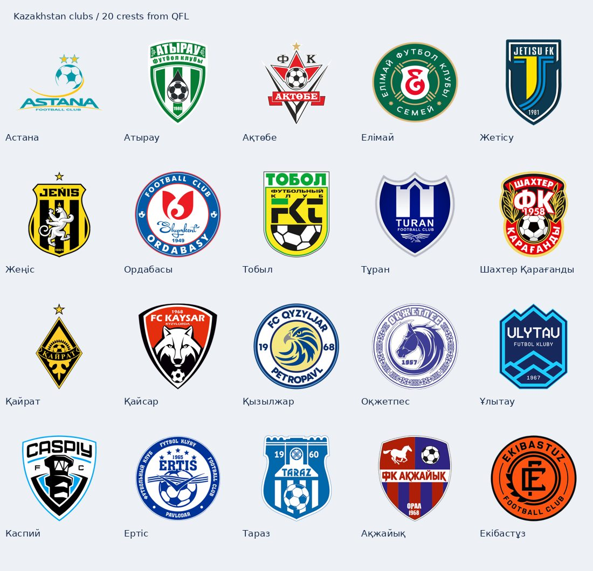

# Football Shorts — логотиптер қоры

**40 эмблема дайын:** 20 ұлттық федерация және Қазақстанның 20 клубы. Бағдарламаға қосу келесі кезеңде жасалады; қазіргі нұсқа бұл каталогты әлі оқымайды.

## Ұлттық құрамалар — 20

FIFA-ның ресми қауымдастық суреттері қолданылды. Бұл — федерация эмблемалары; жейдедегі белгімен бірдей болуы міндетті емес. Испания үшін күмәнді жұлдыз нұсқасының орнына FIFA берген RFEF эмблемасы алынды. Франция, Германия, Колумбия, Мексика суреттерінің ішіндегі ақ фон дереккөздегідей сақталған.

| Атауы | Файл | Дереккөз |
|---|---|---|
| Қазақстан | [Kazakhstan](national/kazakhstan.png) | [FIFA](https://inside.fifa.com/associations/KAZ) |
| Аргентина | [Argentina](national/argentina.png) | [FIFA](https://inside.fifa.com/associations/ARG) |
| Бразилия | [Brazil](national/brazil.png) | [FIFA](https://inside.fifa.com/associations/BRA) |
| Франция | [France](national/france.png) | [FIFA](https://inside.fifa.com/associations/FRA) |
| Англия | [England](national/england.png) | [FIFA](https://inside.fifa.com/associations/ENG) |
| Испания | [Spain](national/spain.png) | [FIFA](https://inside.fifa.com/associations/ESP) |
| Германия | [Germany](national/germany.png) | [FIFA](https://inside.fifa.com/associations/GER) |
| Португалия | [Portugal](national/portugal.png) | [FIFA](https://inside.fifa.com/associations/POR) |
| Италия | [Italy](national/italy.png) | [FIFA](https://inside.fifa.com/associations/ITA) |
| Нидерланд | [Netherlands](national/netherlands.png) | [FIFA](https://inside.fifa.com/associations/NED) |
| Бельгия | [Belgium](national/belgium.png) | [FIFA](https://inside.fifa.com/associations/BEL) |
| Хорватия | [Croatia](national/croatia.png) | [FIFA](https://inside.fifa.com/associations/CRO) |
| Уругвай | [Uruguay](national/uruguay.png) | [FIFA](https://inside.fifa.com/associations/URU) |
| Колумбия | [Colombia](national/colombia.png) | [FIFA](https://inside.fifa.com/associations/COL) |
| Мексика | [Mexico](national/mexico.png) | [FIFA](https://inside.fifa.com/associations/MEX) |
| АҚШ | [United States](national/usa.png) | [FIFA](https://inside.fifa.com/associations/USA) |
| Жапония | [Japan](national/japan.png) | [FIFA](https://inside.fifa.com/associations/JPN) |
| Оңтүстік Корея | [South Korea](national/south-korea.png) | [FIFA](https://inside.fifa.com/associations/KOR) |
| Марокко | [Morocco](national/morocco.png) | [FIFA](https://inside.fifa.com/associations/MAR) |
| Өзбекстан | [Uzbekistan](national/uzbekistan.png) | [FIFA](https://inside.fifa.com/associations/UZB) |

## Қазақстан клубтары — 20

QFL клубтар каталогындағы эмблемалар алынды. Бұл тізім белгілі бір маусымның Премьер-лига құрамын білдірмейді: бірнеше лигадағы клубтарды қамтиды.

| Клуб | Файл | Дереккөз |
|---|---|---|
| Астана | [Astana](clubs/kazakhstan/astana.png) | [QFL](https://qfl.kz/team/12/) |
| Атырау | [Atyrau](clubs/kazakhstan/atyrau.png) | [QFL](https://qfl.kz/team/1/) |
| Ақтөбе | [Aktobe](clubs/kazakhstan/aktobe.png) | [QFL](https://qfl.kz/team/22/) |
| Елімай | [Elimai](clubs/kazakhstan/elimai.png) | [QFL](https://qfl.kz/team/219/) |
| Жетісу | [Zhetysu](clubs/kazakhstan/zhetysu.png) | [QFL](https://qfl.kz/team/23/) |
| Жеңіс | [Zhenis](clubs/kazakhstan/zhenis.png) | [QFL](https://qfl.kz/team/208/) |
| Ордабасы | [Ordabasy](clubs/kazakhstan/ordabasy.png) | [QFL](https://qfl.kz/team/25/) |
| Тобыл | [Tobol](clubs/kazakhstan/tobol.png) | [QFL](https://qfl.kz/team/13/) |
| Тұран | [Turan](clubs/kazakhstan/turan.png) | [QFL](https://qfl.kz/team/197/) |
| Шахтер Қарағанды | [Shakhter Karagandy](clubs/kazakhstan/shakhter-karagandy.png) | [QFL](https://qfl.kz/team/2/) |
| Қайрат | [Kairat](clubs/kazakhstan/kairat.png) | [QFL](https://qfl.kz/team/29/) |
| Қайсар | [Kaisar](clubs/kazakhstan/kaisar.png) | [QFL](https://qfl.kz/team/45/) |
| Қызылжар | [Kyzylzhar](clubs/kazakhstan/kyzylzhar.png) | [QFL](https://qfl.kz/team/34/) |
| Оқжетпес | [Okzhetpes](clubs/kazakhstan/okzhetpes.png) | [QFL](https://qfl.kz/team/28/) |
| Ұлытау | [Ulytau](clubs/kazakhstan/ulytau.png) | [QFL](https://qfl.kz/team/217/) |
| Каспий | [Kaspiy](clubs/kazakhstan/kaspiy.png) | [QFL](https://qfl.kz/team/38/) |
| Ертіс | [Ertis Pavlodar](clubs/kazakhstan/ertis.png) | [QFL](https://qfl.kz/team/27/) |
| Тараз | [Taraz](clubs/kazakhstan/taraz.png) | [QFL](https://qfl.kz/team/26/) |
| Ақжайық | [Akzhayik](clubs/kazakhstan/akzhayik.png) | [QFL](https://qfl.kz/team/30/) |
| Екібастұз | [Ekibastuz](clubs/kazakhstan/ekibastuz.png) | [QFL](https://qfl.kz/team/50/) |

## Каталог және тексеру

`catalog.json`: қазақша, орысша, ағылшынша атаулар; балама атаулар; файлдың салыстырмалы жолы; нақты сурет URL-і; SHA-256; тексеру күні; эмблема түрі. Барлық PNG 256×256. Фон мен пропорциялар түпнұсқаға сай сақталады; сыртқы жиек мөлдір.

`approved_for_auto_use=true` — атау мен дереккөз тексерілгенін білдіреді. Бұл лицензиялық рұқсат немесе кез келген маусымның жейде нұсқасына сәйкестік туралы мәлімдеме емес. Федерация/клуб эмблемаларының құқықтары тиісті иелеріне тиесілі; код лицензиясы оларға автоматты қолданылмайды.

## Бағдарламаға қосу кезіндегі талаптар

- Қолмен таңдалған логотипке басымдық беру.
- Қорды бағдарлама жанындағы `logos` папкасынан салыстырмалы жолмен оқу.
- Атауды тек нақты балама атаулармен сәйкестендіру. Ел/клуб түрі белгісіз болса, бірдей атаулардан кездейсоқ таңдамау.
- «Шахтер» сияқты көпмәнді атауларға ел немесе толық клуб атауы қажет. Жастар/резерв жұрнақтарын алып тастамау.
- Логотип табылмаса, команда атауын ғана көрсету. Ойдан қалқан немесе басқа белгі салмау.
- Жаңарту қолданушы қосқан суреттерді өшірмеуі тиіс.

## Келесі кезек

1. Англия клубтары.
2. Испания → Германия → Италия → Франция → Португалия → Нидерланд → Түркия → Бразилия → Аргентина → Сауд Арабиясы → АҚШ → Бельгия → Шотландия → Жапония → Оңтүстік Корея.

Бұл ресми танымалдық рейтингі емес, жинауға арналған жұмыс реті. Әр топтан кейін келесі елдер санын қолданушы таңдайды.
