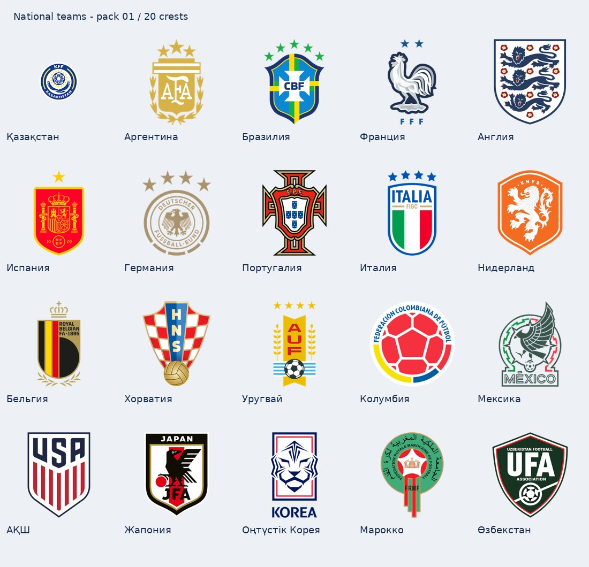

# Ұлттық құрамалар: 1-кезең

**20 эмблема жиналды.** 256×256 PNG, мөлдір фон. Бұл әзірге бөлек қор: бағдарламаға автоматты қосылмаған.

## Каталог

Қазақша, орысша, ағылшынша атаулар және нақты сәйкестендіруге арналған балама атаулар `catalog.json` ішінде. Жолдар осы `logos` папкасына қатысты.

Барлық суреттердің командаға сәйкестігі көзбен қаралды. Соңғы маусым нұсқасы толық тексерілмеген: `approved_for_auto_use=false`. Испанияның бір жұлдызды нұсқасын жаңарту қажет. Қазақстан эмблемасы ҚФФ сайтының өзінен алынды.

| Құрама | Сурет |
|---|---|
| Қазақстан | [Kazakhstan](national/kazakhstan.png) |
| Аргентина | [Argentina](national/argentina.png) |
| Бразилия | [Brazil](national/brazil.png) |
| Франция | [France](national/france.png) |
| Англия | [England](national/england.png) |
| Испания | [Spain](national/spain.png) |
| Германия | [Germany](national/germany.png) |
| Португалия | [Portugal](national/portugal.png) |
| Италия | [Italy](national/italy.png) |
| Нидерланд | [Netherlands](national/netherlands.png) |
| Бельгия | [Belgium](national/belgium.png) |
| Хорватия | [Croatia](national/croatia.png) |
| Уругвай | [Uruguay](national/uruguay.png) |
| Колумбия | [Colombia](national/colombia.png) |
| Мексика | [Mexico](national/mexico.png) |
| АҚШ | [United States](national/usa.png) |
| Жапония | [Japan](national/japan.png) |
| Оңтүстік Корея | [South Korea](national/south-korea.png) |
| Марокко | [Morocco](national/morocco.png) |
| Өзбекстан | [Uzbekistan](national/uzbekistan.png) |

## Дереккөздер

Қазақстан: https://kff.kz/kk (https://kff.kz/images/logo-alone.png).
Қалғандары: https://github.com/Sachawd/wc26-assets, commit 678d8838fb1e3e89e830ad02da55cd44d1fa5eb9. Әр файлдың нақты сілтемесі мен SHA-256 каталогта сақталған.
Эмблемалардың құқықтары тиісті федерациялар мен құқық иелеріне тиесілі. Кодтың лицензиясы осы суреттерге автоматты түрде қолданылмайды; ашық лицензия берілген деп мәлімдемейміз.

## Келесі кезеңдер

1. Құрамалардың нұсқаларын тексеріп, автоматты қолдануға жарамдысын бекіту.
2. Қазақстан клубтары.
3. Англия клубтары.
4. Испания, Германия, Италия, Франция, Португалия, Нидерланд, Түркия, Бразилия, Аргентина, Сауд Арабиясы, АҚШ, Бельгия, Шотландия, Жапония, Оңтүстік Корея. Бұл ресми рейтинг емес, жинаудың жұмыс реті.

Бағдарламаға қосқанда: қолмен таңдалған сурет → бекітілген жергілікті каталог → атау ғана. Белгісіз командаға ойдан эмблема салынбайды. Жаңарту қолданушы қосқан суреттерді өшірмеуі тиіс.
